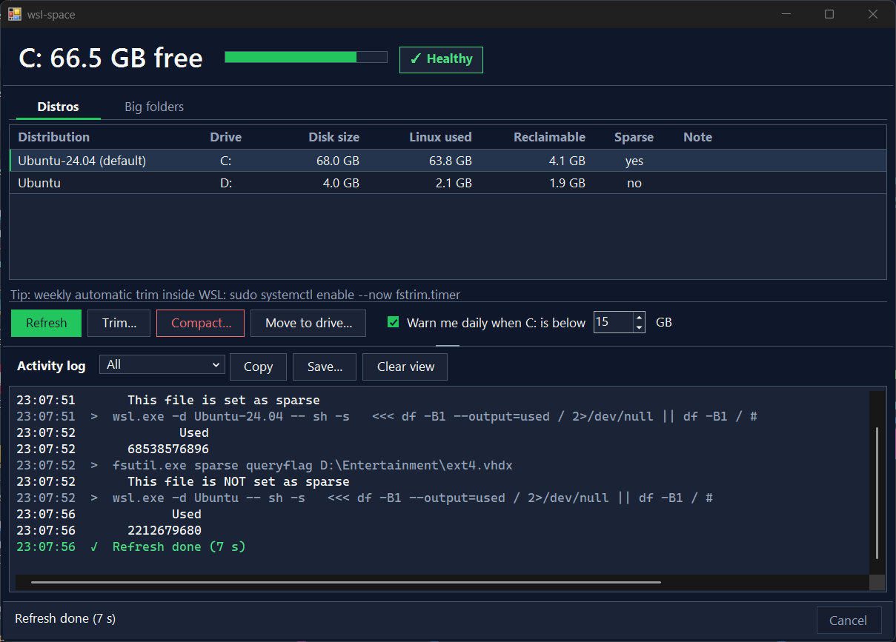

# wsl-space

A small Windows tool that shows how much of C: your WSL distributions really use, finds what is big,
gives space back to C:, and warns before C: runs low.



**Why:** each distro lives in a virtual disk (`ext4.vhdx`) on C:. It grows when Linux needs space but
never shrinks when you delete files, so C: fills up silently. `df -h /` inside Linux shows the disk's
~1 TB maximum, not C:'s real free space.

## Install

**From the PowerShell Gallery** (Windows PowerShell):

```powershell
Install-Script wsl-space -Scope CurrentUser   # answer Yes to add it to PATH
wsl-space.ps1                                 # opens the window (new PowerShell window)
```

If scripts are blocked, run once: `Set-ExecutionPolicy -Scope CurrentUser RemoteSigned`.
Update later with `Update-Script wsl-space`.

**From GitHub:** download the ZIP (Code › Download ZIP) and extract it, or `git clone` this repo.
Then double-click `wsl-space.cmd`. Windows may warn the first time because the script is not signed.

**Requirements:** Windows PowerShell 5.1 and WSL 2; nothing else to install. Move needs WSL 2.5+.
Tested on Windows 11 with WSL 3.0.5, Ubuntu 24.04 and Docker Desktop.

## Use

The window lists each distro with the drive its disk is on, its size, the space Linux uses and what
can be reclaimed. Select a row, then:

| Action | What it does | Stops WSL? |
|---|---|---|
| **Trim** | `fstrim` inside the distro. Freed space goes back to C: when the disk is sparse. | No |
| **Compact** | Shrinks the disk file with `diskpart` (needs admin). Reports how much the file itself shrank. | Yes, all of WSL |
| **Move to drive** | Moves the disk to another drive with `wsl --manage --move`. | Yes, all of WSL |
| **Big folders** tab | Biggest folders in a distro (`du`), with *Open in Explorer*. | No |
| **Warn me daily** | Scheduled task (09:00 and at logon) that notifies when C: is below the threshold. | No |

**Docker Desktop's** data disk is listed as *Docker Desktop data*. Free space with `docker system
prune` while Docker Desktop runs; to Compact it, quit Docker Desktop first.

Tip: let Linux trim itself weekly with `sudo systemctl enable --now fstrim.timer`.

### Command line

| Switch | What it does |
|---|---|
| `-Report` | The distro table plus C: free space. |
| `-BigFolders [-Distro x] [-Path p] [-Depth n] [-Top k]` | Biggest folders, default `~`, depth 3, top 25. |
| `-Trim [-Distro x]` | Trim one distro. |
| `-Compact <distro>` | Compact one disk (asks for admin). |
| `-Move <distro> -To <folder>` | Move one disk to another drive. |
| `-Check [-ThresholdGB n]` | Notify if C: is low. Does not start WSL. |
| `-SelfTest` | Run the built-in tests. |

Without `-Distro`, the distro with the biggest disk is used.

## Safety

- **It never deletes files.** It shows what is big; you decide what to remove.
- **Compact and Move ask first** and say that all WSL sessions will stop (save your work). Move
  refuses before stopping anything if the target is on the same drive, a drive root, already holds a
  disk, or lacks space; if WSL's move fails, the distro stays where it was.
- **Nothing irreversible:** no `wsl --unregister`, no removing distros.
- **Every command it runs is shown in the activity log.**

## License

[MIT](LICENSE).
